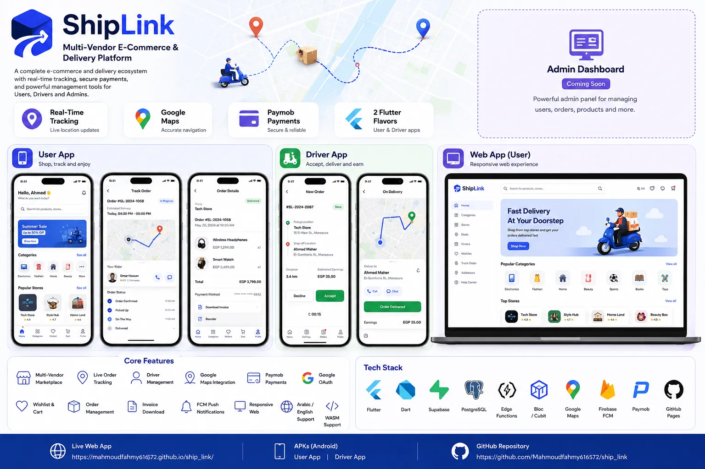

# 📦 ShipLink — E-Commerce & Delivery Platform

**ShipLink** is a production-shaped e-commerce & delivery system built from a **single
Flutter codebase** that ships **5 targets**: an Android User app, an Android Driver app,
a responsive Web store, a Driver web app, and an Admin panel.

| Target | Entry point | Where it runs |
|---|---|---|
| User app (Android) | `lib/user/main_user.dart` (flavor `user`) | Signed APK — `com.shiplink.app.user` |
| Driver app (Android) | `lib/driver/main_driver.dart` (flavor `driver`) | Signed APK — `com.shiplink.app.driver` |
| Web store | `lib/web/main_web.dart` | `/ship_link/` |
| Driver web | `lib/web/main_web.dart` | `/ship_link/driver/` |
| Admin panel | `lib/web/main_web.dart` | `/ship_link/admin/` |

> The Android builds are distributed as signed release APKs for now (download links below);
> the Google Play listing is not live yet.

> The web entry (`lib/web/main_web.dart`) branches on the URL path: `admin` → admin login,
> `driver` → driver sign-in, otherwise → storefront. All three web builds come from the
> same target with a different `--base-href`.

## ✨ Highlights

* **Live delivery tracking** — driver GPS streams over Supabase **Realtime** onto a
  **FlutterMap + MapTiler** renderer (Google Maps kept only as an opt-in legacy
  fallback via `MapService.enableGoogleRenderer`), with polyline routes, ETA,
  custom markers, and Huawei/Honor-safe tile rendering.
* **Payments** — **Paymob** (new card, saved card, 3DS callback handled by Edge
  Functions) plus **Cash on Delivery**.
* **Full commerce flow** — product catalog with categories, search, filters and
  sorting, offers & top sellers, stock-watch, cart, wishlist, checkout, promo codes,
  reviews, driver ratings, invoice download (PDF), order chat and support chat.
* **Driver module** — online/offline toggle, order acceptance, pickup → delivery
  flow, earnings dashboard, background location session.
* **Admin panel** — dashboard, users, drivers, orders and products management.
* **Notifications** — FCM via the `send_push` Edge Function, plus local
  notifications with a 10s polling fallback on the `notifications` table.
* **Auth** — email/password + OTP, and **Google OAuth** through
  `Supabase.auth.signInWithOAuth`.
* **Bilingual** — English / Arabic through a custom `AppLocalizations` delegate.

## 🛠️ Tech Stack

| Layer | Technology |
|---|---|
| App | Flutter (Dart 3), BLoC/Cubit (Provider/ChangeNotifier on web), GoRouter |
| Backend | **Supabase** — Postgres, Auth, Row Level Security, Realtime, Edge Functions |
| Payments | Paymob Edge Functions (`paymob-checkout`, `paymob-add-card`, `paymob-saved-card-checkout`, `paymob-callback`) |
| Maps | FlutterMap + **MapTiler** (tiles & geocoding), Nominatim fallback, `google_maps_flutter` (legacy opt-in) |
| Push | Firebase Cloud Messaging + `flutter_local_notifications` |
| HTTP | `supabase_flutter` client; `http` for MapTiler/Nominatim geocoding |
| Local storage | sqflite cache, SharedPreferences, flutter_secure_storage |
| Quality | 111 tests (tracking, routing, geocoding, models, cubits) · `flutter analyze` → **0 errors** |

## ▶️ Getting Started

```bash
git clone https://github.com/Mahmoudfahmy616572/ship_link.git
cd ship_link
flutter pub get

# copy the env template and fill in real values
cp .env.example .env

# Android — User app
flutter run --flavor user -t lib/user/main_user.dart --dart-define-from-file=.env

# Android — Driver app
flutter run --flavor driver -t lib/driver/main_driver.dart --dart-define-from-file=.env

# Web — storefront / driver / admin (branches on the URL path)
flutter run -d chrome -t lib/web/main_web.dart
```

### Release builds

```bash
# User APKs (arm64 / armeabi-v7a / x86_64)
flutter build apk --flavor user -t lib/user/main_user.dart --release --split-per-abi --dart-define-from-file=.env

# Driver APKs
flutter build apk --flavor driver -t lib/driver/main_driver.dart --release --split-per-abi --dart-define-from-file=.env

# Play Store bundle
flutter build appbundle --flavor user -t lib/user/main_user.dart --release --dart-define-from-file=.env
flutter build appbundle --flavor driver -t lib/driver/main_driver.dart --release --dart-define-from-file=.env

# Web
flutter build web -t lib/web/main_web.dart --release --no-wasm-dry-run
```

### Build-time configuration (`.env`)

Read through `--dart-define-from-file=.env` (see `lib/core/config.dart`,
`lib/core/maps/renderer/maptiler_config.dart`). Never commit `.env`.

```
SUPABASE_URL=            # https://<project>.supabase.co
SUPABASE_ANON_KEY=       # publishable anon key
GOOGLE_MAPS_API_KEY=     # legacy renderer opt-in
MAPTILER_API_KEY=        # primary tiles + geocoding (falls back to OSM without it)
FIREBASE_API_KEY=        # FCM
FIREBASE_APP_ID=
FIREBASE_MESSAGING_SENDER_ID=
FIREBASE_PROJECT_ID=
FIREBASE_STORAGE_BUCKET=
```

## 🗄️ Database

Run in the **Supabase SQL Editor**, in this order:

1. `supabase/apply_all.sql` — schema + RLS (superset: includes `stock_watch`,
   `payment_methods`, and the "drivers can view available orders" policy)
2. `supabase/sql/admin_supabase_schema.sql` — `admins` table, policies and trigger
3. Anything still missing under `supabase/migrations/`

Full details: [`supabase/sql/README.md`](supabase/sql/README.md)

### Edge Functions

```bash
npx supabase functions deploy paymob-checkout                 --project-ref <ref>
npx supabase functions deploy paymob-add-card                 --project-ref <ref>
npx supabase functions deploy paymob-saved-card-checkout      --project-ref <ref>
npx supabase functions deploy paymob-callback                 --project-ref <ref> --no-verify-jwt
npx supabase functions deploy send_push                       --project-ref <ref>
```

> `paymob-callback` is hit by a browser redirect (no JWT), so it **must** be deployed
> with `--no-verify-jwt`.

## 📦 Download

* **Web store:** https://mahmoudfahmy616572.github.io/ship_link/
* **Admin panel:** https://mahmoudfahmy616572.github.io/ship_link/admin/
* **Driver web:** https://mahmoudfahmy616572.github.io/ship_link/driver/
* **User APK:** [v1.1.0 arm64](https://github.com/Mahmoudfahmy616572/ship_link/releases/download/v1.1.0/app-arm64-v8a-user-release.apk)
* **Driver APK:** [v1.1.0 arm64](https://github.com/Mahmoudfahmy616572/ship_link/releases/download/v1.1.0/app-arm64-v8a-driver-release.apk)
* **Privacy Policy:** https://mahmoudfahmy616572.github.io/ship_link/privacy-policy.html
* **Delete Account:** https://mahmoudfahmy616572.github.io/ship_link/delete-account.html

## 📸 Project Preview



| Web store | Driver web | Admin panel |
| :---: | :---: | :---: |
| [Open](https://mahmoudfahmy616572.github.io/ship_link/) | [Open](https://mahmoudfahmy616572.github.io/ship_link/driver/) | [Open](https://mahmoudfahmy616572.github.io/ship_link/admin/) |

## 🧭 Project Docs

* [`AGENTS.md`](AGENTS.md) — build commands, architecture rules, known pitfalls
* [`supabase/sql/README.md`](supabase/sql/README.md) — database setup order
* [`FCM_SETUP.md`](FCM_SETUP.md) — Firebase Cloud Messaging wiring

## ⚖️ License

© Mahmoud Fahmy. All rights reserved — see [`LICENSE`](LICENSE). The source is public for
review and evaluation only; copying it into another product is not permitted.

White-labelling, licensing or acquisition: **mahmoudfahmeyy@gmail.com**

